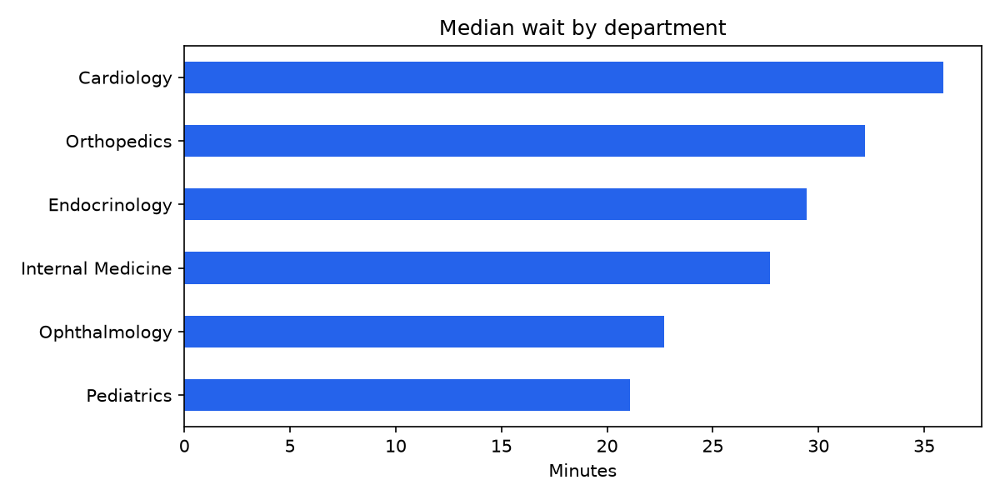

# Phân tích vận hành khám ngoại trú

Đồ án Data Analyst mô phỏng bài toán vận hành của một cơ sở khám ngoại trú tại Buôn Ma Thuột. Mục tiêu là giúp bộ phận vận hành xác định nơi phát sinh thời gian chờ dài, theo dõi tình trạng vắng hẹn và ưu tiên đúng chuyên khoa, khung giờ trước khi thảo luận thay đổi lịch khám hoặc nhân sự.

> Toàn bộ 6.500 lịch hẹn trong đồ án là dữ liệu mô phỏng có thể tái tạo bằng mã nguồn. Dự án không sử dụng và không đại diện cho dữ liệu của bệnh viện hay bệnh nhân thật.

## Website tương tác

**[Mở dashboard công khai](https://khanhnguyenpham.github.io/outpatient-operations-analysis/)**

Bản web tĩnh tải nhanh, không yêu cầu đăng nhập và tính lại KPI, biểu đồ theo bộ lọc ngay trên trình duyệt. Dữ liệu công khai đã loại bỏ mã người bệnh và chỉ giữ các trường cần cho phân tích tổng hợp.

## Nguồn dữ liệu và tính trung thực

Dữ liệu do [`src/ops_analysis/data.py`](src/ops_analysis/data.py) tạo bằng Python với seed 42; không lấy từ Kaggle, Bệnh viện Thiện Hạnh hoặc bất kỳ cơ sở y tế thật nào. Bộ sinh mô phỏng các quan hệ có chủ đích để kiểm tra quy trình phân tích, vì vậy phát hiện chỉ chứng minh năng lực xây pipeline và lập luận trên dữ liệu, không chứng minh hiện trạng của một bệnh viện.

Các giả định và rủi ro khi chuyển sang dữ liệu thật được công khai trong [sổ đăng ký giả định](docs/assumptions.md).

## Vị trí trong portfolio

Đây là project chuyên về **Data Analyst**: bắt đầu từ câu hỏi nghiệp vụ, định nghĩa KPI, kiểm tra chất lượng, mô hình dữ liệu và SQL rồi mới đến dashboard. Project không thêm mô hình dự đoán để câu chuyện tuyển dụng không bị trộn với repository [AI Systems](https://github.com/khanhnguyenpham/hospital-appointment-risk-system). Phần Python backend và transaction được thể hiện riêng trong [Kho Gọn](https://github.com/khanhnguyenpham/inventory-order-management).

Các mốc thay đổi của chính repository này được ghi theo ngày commit thật trong [CHANGELOG](CHANGELOG.md). Bối cảnh học tập 2022–2026 nằm trên [trang GitHub cá nhân](https://github.com/khanhnguyenpham).

## Kết quả chính

- Tỷ lệ vắng hẹn chung là **13,79%**; mẫu số loại trừ lịch đã hủy.
- Thời gian chờ trung vị là **27,7 phút**, trong khi P90 là **43,9 phút**. P90 giúp không che khuất nhóm phải chờ lâu.
- **Tim mạch** có thời gian chờ cao nhất: trung vị **35,9 phút**, P90 **50,5 phút**.
- Ba lát cắt ổn định cần rà soát đầu tiên là Tim mạch lúc **09:00, 10:00 và 14:00**.
- Chờ bắt đầu khám là thành phần lớn nhất ở Tim mạch: trung bình **20,8/35,6 phút**.
- Ba khung giờ ưu tiên không thay đổi khi dùng ngưỡng tối thiểu **30, 50 hoặc 70 lượt**.
- Không có tháng nào vượt giới hạn kiểm soát ba sigma của tỷ lệ vắng hẹn.
- Nhóm có ghi nhận nhắc hẹn có tỷ lệ vắng thấp hơn **6,24 điểm phần trăm**; đây là liên hệ mô tả, không phải bằng chứng nhân quả.

Phân tích đầy đủ, giới hạn và đề xuất hành động nằm trong [báo cáo phân tích](reports/analysis_report.md).

## Câu hỏi nghiệp vụ

1. Nhu cầu khám tập trung vào thời điểm nào?
2. Chuyên khoa nào có phân phối thời gian chờ đáng chú ý nhất?
3. Những tổ hợp chuyên khoa – khung giờ nào nên được rà soát trước?
4. Công đoạn nào đóng góp nhiều nhất vào tổng thời gian chờ?
5. Kết luận ưu tiên có thay đổi khi đổi ngưỡng cỡ mẫu không?
6. Tỷ lệ vắng theo tháng có vượt giới hạn kiểm soát thống kê không?
7. Việc ghi nhận nhắc hẹn có liên hệ như thế nào với tỷ lệ vắng hẹn?

## Quy trình xử lý

```text
Dữ liệu mô phỏng
      │
      ▼
Kiểm tra chất lượng từng dòng
      │
      ▼
Kho dữ liệu SQLite dạng sao
      │
      ├──► Truy vấn SQL nghiệp vụ
      ├──► Báo cáo quyết định
      ├──► Dashboard Streamlit
      └──► Website GitHub Pages
```

Mỗi lần chạy, hệ thống đối soát số dòng giữa nguồn, bảng sự kiện và view báo cáo; đồng thời kiểm tra khóa ngoại mồ côi. Các truy vấn SQL được đặt tên và xuất riêng để dễ kiểm tra.

## Chạy dự án trên máy

Yêu cầu Python 3.11 trở lên.

```powershell
python -m venv .venv
.venv\Scripts\Activate.ps1
pip install -r requirements-dev.txt
python run_analysis.py
python scripts/build_static_site.py
streamlit run dashboard.py
```

Sau khi chạy lệnh cuối, mở `http://localhost:8501`. Dashboard tự tạo dữ liệu mẫu nếu chưa có hoặc nếu phát hiện tệp thuộc phiên bản cũ.

## Kiểm tra chất lượng

```powershell
ruff check .
ruff format --check .
pytest
python run_analysis.py
python scripts/build_static_site.py
```

Bộ kiểm thử bao phủ quy tắc dữ liệu, mẫu số KPI, nâng cấp dữ liệu demo cũ, đối soát kho dữ liệu và khả năng thực thi của toàn bộ truy vấn nghiệp vụ. GitHub Actions chạy lại các bước này sau mỗi lần cập nhật mã nguồn.

Sau mỗi lần chạy, `reports/generated/data_quality.json` lưu số dòng, mã lịch hẹn trùng, trường thiếu và sai lệch giữa tổng ba công đoạn với thời gian chờ. Tệp này giúp CI hoặc công cụ khác đọc kết quả kiểm tra mà không phải phân tích báo cáo Markdown.

## Cấu trúc thư mục

```text
data/                 dữ liệu CSV và SQLite được tạo khi chạy
docs/                 định nghĩa KPI, mô hình và từ điển dữ liệu
reports/              báo cáo phân tích dành cho người đọc nghiệp vụ
sql/analysis.sql      các truy vấn SQL có hàm cửa sổ
src/ops_analysis/     sinh, kiểm tra và xử lý dữ liệu
tests/                kiểm thử logic phân tích và kho dữ liệu
dashboard.py          dashboard tương tác bằng Streamlit
run_analysis.py       chạy toàn bộ quy trình bằng một lệnh
scripts/              tạo dữ liệu tối thiểu cho website tĩnh
```

## Tài liệu kỹ thuật

- [Báo cáo phân tích và khuyến nghị](reports/analysis_report.md)
- [Bản tóm tắt yêu cầu nghiệp vụ](docs/stakeholder_brief.md)
- [Sổ đăng ký giả định](docs/assumptions.md)
- [Định nghĩa chỉ số](docs/metrics.md)
- [Mô hình dữ liệu](docs/data_model.md)
- [Từ điển dữ liệu](docs/data_dictionary.md)
- [Truy vấn SQL](sql/analysis.sql)
- [Tiếp tục dự án trên laptop khác](docs/laptop_workflow.md)
- [Trạng thái hiện tại của dự án](docs/project_status.md)
- [Lịch phát triển](CHANGELOG.md)



## Giới hạn sử dụng

Dữ liệu mô phỏng giúp kết quả có thể tái tạo nhưng không đủ để đưa ra quyết định vận hành thật. Nếu làm với dữ liệu thực tế, bước tiếp theo là thống nhất định nghĩa với nhân viên tiếp nhận và vận hành, tách thời gian chờ thành từng công đoạn, kiểm tra dữ liệu thiếu, phân quyền truy cập và đánh giá yếu tố gây nhiễu trước khi triển khai can thiệp.
